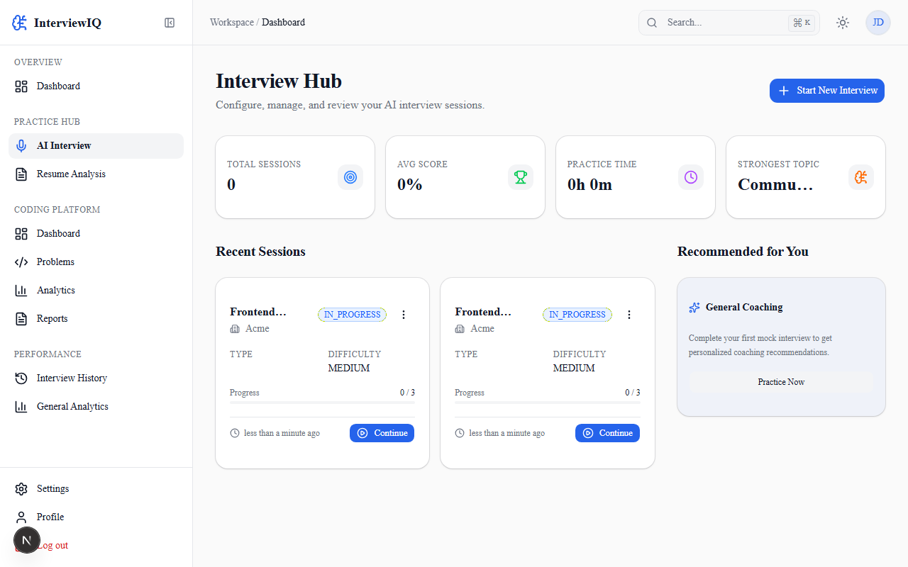
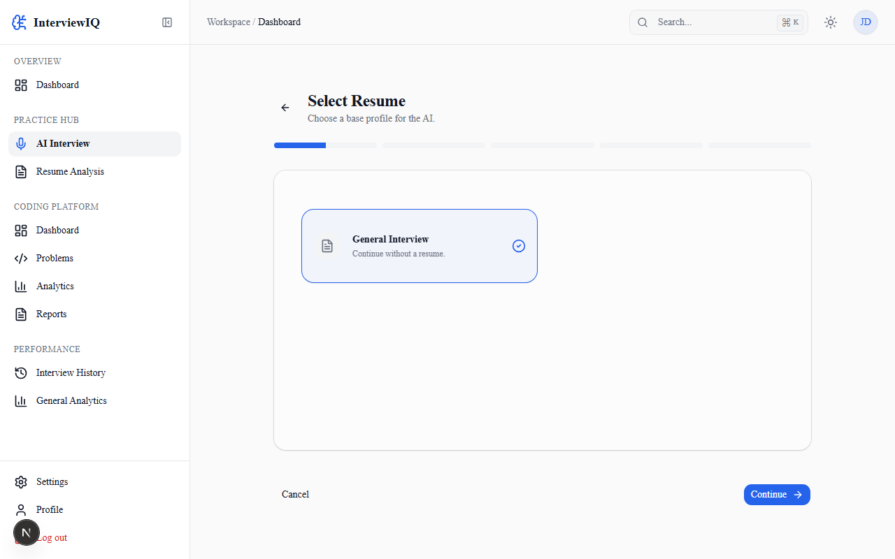
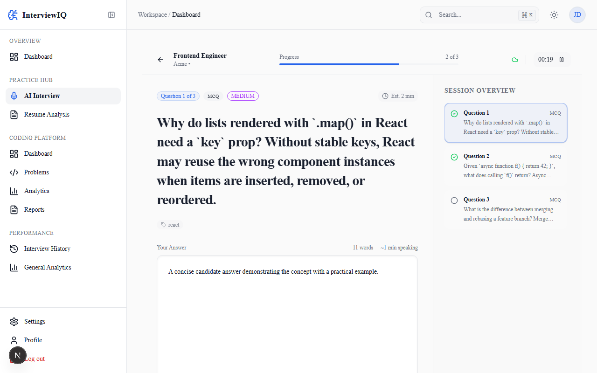
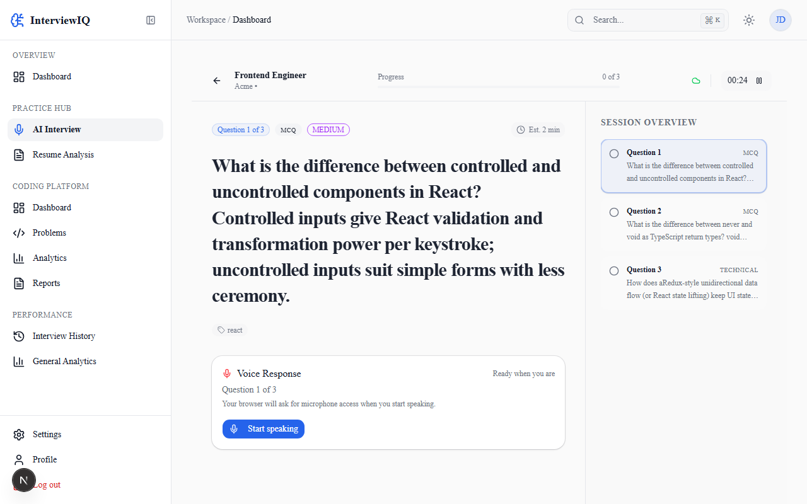
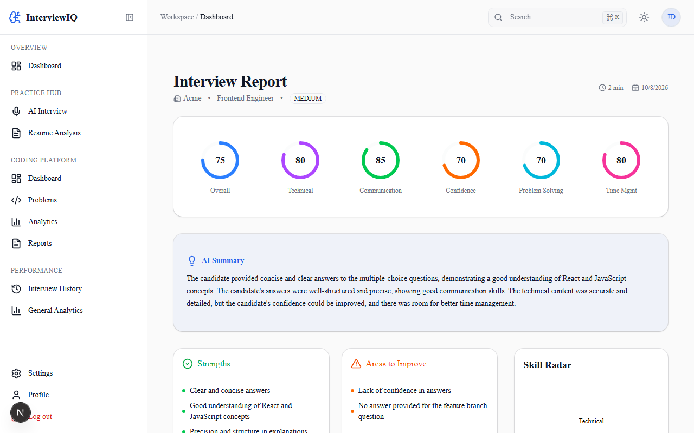
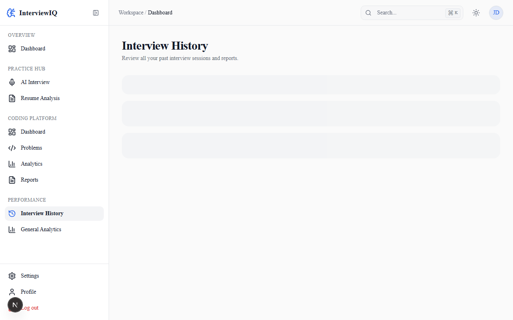
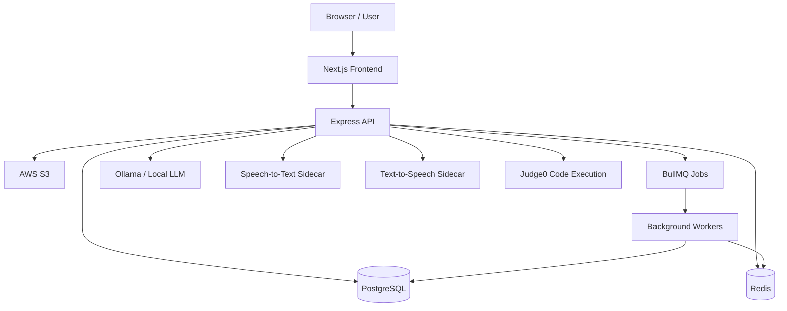

# InterviewIQ — AI-Powered Interview Platform

InterviewIQ is a full-stack AI-powered interview platform designed to help candidates practise technical interviews, receive structured feedback, and track their progress. It combines conversational AI, voice processing, coding assessments, resume analysis, and interview analytics in one application.

---

## Demo

▶ [Watch the InterviewIQ demo](images/demo.mp4)

The demo shows the interview workflow, answer submission, AI-generated evaluation, and completed report.

---

## Screenshots

### Dashboard and interview setup




### Interview experiences




### Results and history




---

## Key Features

| Feature | Description |
|---|---|
| AI-powered interviews | Conduct structured interviews with AI-generated questions and follow-ups. |
| Voice interviews | Support spoken responses using speech-to-text, language-model processing, and text-to-speech. |
| Live coding | Provide coding interview workflows, code execution integration, and coding review capabilities. |
| Resume analysis | Upload PDF or DOCX resumes for analysis and interview preparation. |
| Interview scheduling | Support interview scheduling and schedule updates. |
| Evaluation reports | Generate structured interview evaluations, scores, and feedback. |
| Interview analytics | Review interview history, statistics, timelines, achievements, and coaching insights. |
| Question bank | Organize interview questions using question and taxonomy APIs. |
| Authentication | Support JWT authentication, refresh-token rotation, Google OAuth, and account recovery flows. |

---

## Technology Stack

**Frontend**
- Next.js 16
- React 19
- TypeScript
- Tailwind CSS
- Radix UI

**Backend**
- Node.js
- Express
- TypeScript
- Prisma ORM
- PostgreSQL

**AI and supporting services**
- Ollama for local language-model inference
- qwen2.5:3b-instruct as the configured local model
- faster-whisper for speech-to-text
- Piper for text-to-speech
- Judge0 integration for code execution

**Infrastructure and testing**
- Redis for caching and queue infrastructure
- BullMQ for background jobs
- AWS S3 integration for supported file uploads
- Jest for backend tests
- Playwright for end-to-end testing

---

## Architecture

InterviewIQ separates the web client, API, background processing, database, and supporting AI services.



The diagram represents the major logical components. Individual workflows may use different execution paths depending on the operation.

---

## Project Structure

The project is organised as a monorepo with separate frontend, backend, service, test, and documentation areas.

```
InterviewIQ/
├── apps/
│   ├── web/                 # Next.js frontend
│   └── api/                 # Express API and backend modules
├── services/
│   ├── stt/                 # Speech-to-text service
│   └── tts/                 # Text-to-speech service
├── tests/                   # Shared or end-to-end tests
├── docs/                    # Setup, architecture and deployment docs
├── images/                  # Screenshots and demo video
├── package.json             # Root workspace scripts
├── playwright.config.ts     # Playwright configuration
├── .gitignore
└── README.md
```

Consult the actual repository tree for the complete list of modules and supporting files.

---

## Prerequisites

Install the tools required by the components you intend to run.

| Requirement | Purpose |
|---|---|
| Node.js and npm | JavaScript/TypeScript runtime and dependencies |
| PostgreSQL | Persistent application data |
| Redis | Queue and supporting infrastructure |
| Ollama | Local language-model inference |
| faster-whisper | Speech-to-text service |
| Piper | Text-to-speech service |
| Docker and Docker Compose | Optional containerised infrastructure |
| AWS S3 credentials | Required for S3-backed upload functionality |
| Judge0 configuration | Required for code-execution functionality |

Exact versions, service ports, model downloads, and optional integrations should follow the configuration files and service-specific setup guides in this repository.

---

## Getting Started

### 1. Clone the repository

```bash
git clone https://github.com/dasari-chaithanya/InterviewIQ.git
cd InterviewIQ
```

### 2. Install dependencies

```bash
npm install
```

### 3. Configure environment variables

Create local environment files using the repository's `.env.example` files, where available. Configure the required variables for the API, frontend, database, authentication, email, AI services, and optional integrations.

> **Never commit real credentials or local `.env` files.**

### 4. Start PostgreSQL and Redis

From the directory containing the applicable Compose configuration:

```bash
docker compose up -d postgres redis
```

This starts the PostgreSQL and Redis services defined in that Compose configuration.

### 5. Configure the database

Run the repository's migration command from the monorepo root:

```bash
npm run prisma:migrate -w apps/api
```

Use the Prisma commands documented in the backend package for generating the client and managing schema changes.

### 6. Start the development stack

```bash
npm run dev
```

The root development script starts the configured workspace applications. Ensure the required database, Redis, Ollama, and supporting services are available.

For the complete four-terminal startup sequence, environment configuration, health checks, and service-specific commands, follow the local demo guide: [docs/local-demo.md](docs/local-demo.md)

---

## Environment Variables

The exact required variables depend on the selected features and deployment mode. Use the backend environment schema and the repository's example environment files as the source of truth.

| Variable | Purpose |
|---|---|
| `DATABASE_URL` | PostgreSQL connection string |
| `REDIS_URL` | Redis connection |
| `JWT_SECRET` | Access token secret (min 32 chars, required) |
| `JWT_REFRESH_SECRET` | Refresh token secret (min 32 chars, required) |
| `CORS_ORIGIN` | Allowed frontend origin |
| `AI_PROVIDER` | `ollama` or `openai` |
| `OLLAMA_BASE_URL` | Ollama endpoint |
| `OLLAMA_MODEL` | LLM model name |
| `STT_PROVIDER` | `local` or `disabled` |
| `STT_BASE_URL` | Speech-to-text sidecar URL |
| `TTS_PROVIDER` | `local` or `disabled` |
| `TTS_BASE_URL` | Text-to-speech sidecar URL |
| `JUDGE0_URL` | Code execution endpoint |
| `JUDGE0_KEY` | Code execution API key |
| `STORAGE_PROVIDER` | `LOCAL` or `S3` |
| `AWS_S3_BUCKET` | Primary S3 bucket variable |
| `AWS_BUCKET_NAME` | Alternative S3 bucket variable accepted by the backend |
| `AWS_ACCESS_KEY_ID` | AWS credentials (required when `STORAGE_PROVIDER=S3`) |
| `AWS_SECRET_ACCESS_KEY` | AWS credentials (required when `STORAGE_PROVIDER=S3`) |
| `AWS_REGION` | AWS region (required when `STORAGE_PROVIDER=S3`) |
| `GOOGLE_CLIENT_ID` | Google OAuth client identifier |
| `GOOGLE_CLIENT_SECRET` | Google OAuth client secret; required in production when `GOOGLE_CLIENT_ID` is configured |
| `PASSWORD_RESET_URL` | Password-reset link base URL |
| `EMAIL_VERIFY_URL` | Email-verification link base URL |
| `SMTP_HOST` | Optional SMTP host for email delivery |
| `SMTP_PORT` | Optional SMTP port |
| `SMTP_USER` | Optional SMTP username |
| `SMTP_PASS` | Optional SMTP password |
| `EMAIL_FROM` | Optional sender identity for email delivery |

> The table above highlights key configuration variables; it is not an exhaustive replacement for `apps/api/src/config/env.ts` or the service-specific environment references. Check those files for all settings, defaults, and production requirements.
>
> **Security:** Use strong, unique production secrets. Do not use development placeholder values in production. The backend will refuse to start if known placeholder JWT secrets are detected in production mode.

---

## Running the Stack

The application includes a frontend, API, database, Redis, background processing, and supporting AI services.

For reliable startup:

1. Start the infrastructure services.
2. Apply database migrations.
3. Start the required Ollama model and any required speech or code-execution services.
4. Start the API and frontend using the documented development commands.
5. Verify service health before testing interview workflows.

> **Port note:** The Docker Compose configuration overrides the API port to `3000`, while local development uses the API's default port `8000`. Use the actual Compose and environment configuration when determining the endpoint.

---

## Voice Processing

InterviewIQ integrates separate services for speech recognition and speech generation.

| Component | Technology | Purpose |
|---|---|---|
| Speech-to-text | faster-whisper | Convert spoken responses into text |
| Language model | Ollama | Process interview responses and generate AI output |
| Text-to-speech | Piper | Generate spoken responses |

The configured models include `small` for faster-whisper and `en_US-lessac-medium` for Piper. Resource usage depends on model settings, request size, hardware, and concurrent workloads.

See the individual service READMEs for setup, model downloads, health checks, and troubleshooting.

---

## Database

InterviewIQ uses PostgreSQL for persistent application data and Prisma ORM for database access and migrations.

```bash
# Development migrations
npm run prisma:migrate -w apps/api

# Production: apply committed migrations only
npx prisma migrate deploy

# Open Prisma Studio
npm run prisma:studio -w apps/api

# Regenerate Prisma client after schema changes
npm run prisma:generate -w apps/api
```

Run the production migration command from the backend package context with the correct production environment and database configuration.

> Review the Prisma schema for the authoritative domain models and relationships. Do not commit database dumps or real user records.

---

## API Reference

The API is versioned under `/api/v1`. The following endpoints reflect the verified route paths from the project source.

| Method | Endpoint | Purpose |
|---|---|---|
| `POST` | `/api/v1/auth/register` | Register a new user |
| `POST` | `/api/v1/auth/login` | Login and receive a JWT pair |
| `POST` | `/api/v1/auth/refresh` | Refresh an access token |
| `POST` | `/api/v1/auth/google` | Google OAuth login |
| `POST` | `/api/v1/auth/forgot-password` | Initiate password recovery |
| `POST` | `/api/v1/auth/reset-password` | Complete password reset |
| `GET` | `/api/v1/users/me` | Get current user profile |
| `POST` | `/api/v1/resumes` | Upload a resume (PDF or DOCX) |
| `POST` | `/api/v1/resumes/:resumeId/analysis` | Trigger resume analysis |
| `POST` | `/api/v1/interviews` | Create an interview session |
| `POST` | `/api/v1/interviews/:sessionId/start` | Start an interview |
| `POST` | `/api/v1/interviews/:sessionId/pause` | Pause an interview |
| `POST` | `/api/v1/interviews/:sessionId/end` | End an interview session |
| `POST` | `/api/v1/interviews/:sessionId/questions/:questionId/answer` | Submit an interview answer |
| `POST` | `/api/v1/interviews/:sessionId/voice/turn` | Process a voice-interview turn |
| `POST` | `/api/v1/interviews/:sessionId/evaluate` | Trigger evaluation |
| `GET` | `/api/v1/interviews/:sessionId/evaluation/report` | Retrieve the evaluation report |
| `POST` | `/api/v1/interviews/:sessionId/schedule` | Schedule an interview |
| `GET` | `/api/v1/interviews/analytics` | Retrieve interview analytics |
| `GET` | `/api/v1/interviews/history` | Retrieve interview history |
| `GET` | `/api/v1/coding/problems` | Browse coding problems |
| `POST` | `/api/v1/coding/executions/run` | Run a code execution request |
| `GET` | `/api/v1/question-bank/roles` | List question bank roles |
| `GET` | `/api/v1/question-bank/skills` | List question bank skills |

The backend also provides resume versioning, coding workspaces, submission history, coding review, coaching insights, degree tracking, and additional routes.

For request schemas, response formats, authentication requirements, and the complete endpoint list, consult the Swagger/OpenAPI configuration served by the running API and the route definitions in `apps/api/src/`.

---

## Testing

**Backend tests**

```bash
npm run test -w apps/api
```

Run tests in watch mode during development:

```bash
npm run test:watch -w apps/api
```

**End-to-end tests**

Use the repository's Playwright configuration and documented scripts to run the end-to-end suite.

```bash
npx playwright test
```

**Live speech-to-text tests**

Live STT tests are guarded by the `STT_LIVE=1` environment setting. Follow the speech service documentation before running tests that require a live sidecar or downloaded model.

**Verification status**

The last recorded project verification reported:
- Backend tests: 391/391 passing
- End-to-end interview workflow verified
- Frontend build successful
- TypeScript checks successful
- Prisma checks successful

> These are recorded results, not a guarantee that every future commit passes. Re-run the relevant checks against the commit being published.

---

## Docker Deployment

The backend Compose configuration is located at `apps/api/docker-compose.yml`.

Start the configured stack:

```bash
docker compose -f apps/api/docker-compose.yml up -d
```

After the services are healthy, apply production migrations:

```bash
docker compose -f apps/api/docker-compose.yml exec api npx prisma migrate deploy
```

> Check the Compose environment and port mappings before exposing the API. The current configuration overrides the API port to `3000` for Docker Compose, whereas local development defaults to `8000`.

Review the Compose file and deployment documentation for volumes, health checks, environment configuration, networking, and required external services.

---

## Production Deployment

Production deployment requires more than starting the frontend and API.

Before deploying:

- Configure production environment variables and strong secrets.
- Provision PostgreSQL and Redis.
- Configure authentication callbacks and trusted frontend origins.
- Configure Ollama or the selected inference endpoint.
- Configure speech sidecars and code execution where required.
- Configure S3 permissions and upload policies.
- Apply database migrations.
- Set up a reverse proxy, HTTPS, and appropriate request limits.
- Verify health checks, logs, error handling, and rollback procedures.

**Frontend-only hosting**

The frontend may be hosted separately, including on Vercel, provided the API is deployed and reachable at a correctly configured public URL. A frontend-only deployment does not deploy the backend, database, Redis, Ollama, or speech-processing services.

Follow the repository's deployment guide for supported production topology, reverse-proxy configuration, and rollback procedures: [docs/deployment-guide.md](docs/deployment-guide.md)

---

## Documentation

| Document | Description |
|---|---|
| [docs/local-demo.md](docs/local-demo.md) | Local setup and demo workflow |
| [docs/architecture.md](docs/architecture.md) | Architecture overview |
| [docs/deployment-guide.md](docs/deployment-guide.md) | Production deployment guide |
| [docs/disaster-recovery.md](docs/disaster-recovery.md) | Recovery procedures |
| [docs/operations-runbook.md](docs/operations-runbook.md) | Operations runbook |
| [services/stt/README.md](services/stt/README.md) | Speech-to-text service documentation |
| [services/tts/README.md](services/tts/README.md) | Text-to-speech service documentation |

Check the actual file tree before publishing additional links to individual documentation files.

---

## Contributing

Contributions and improvements are welcome.

1. Fork the repository.
2. Create a feature branch.
3. Make a focused change.
4. Run the relevant tests and checks.
5. Submit a pull request describing the change and its verification.

Please do not include secrets, real user data, generated model artefacts, or private environment files in contributions.

---

## License

This project is licensed under the MIT License. See [LICENSE](LICENSE) for the full license text.
